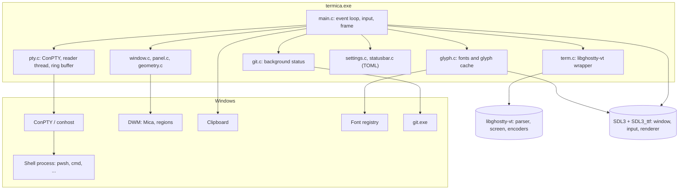
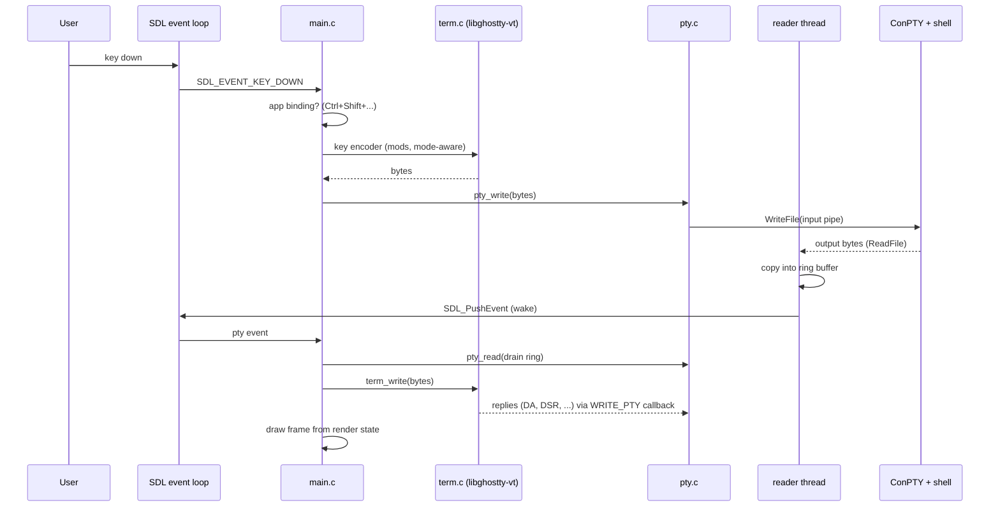
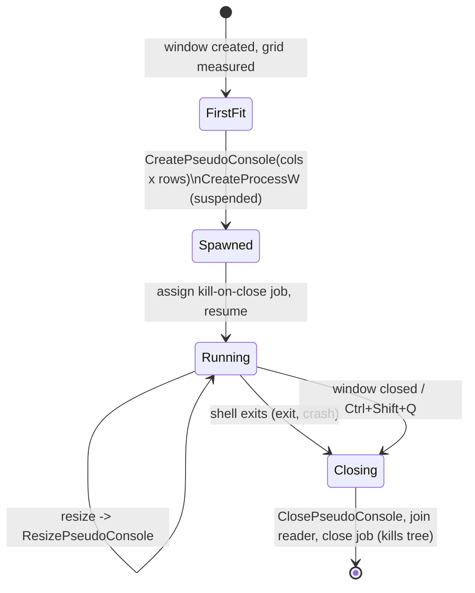
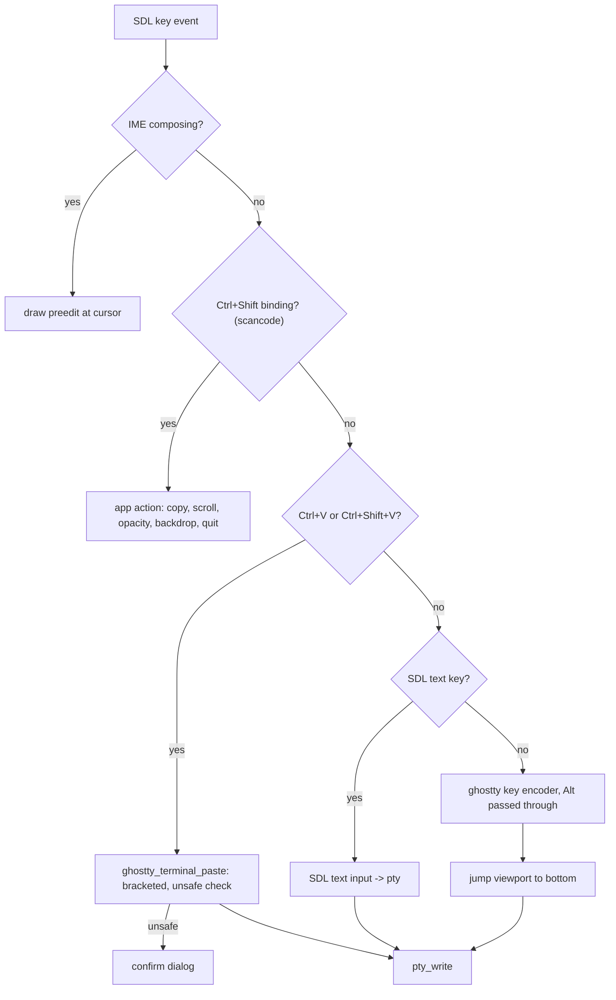
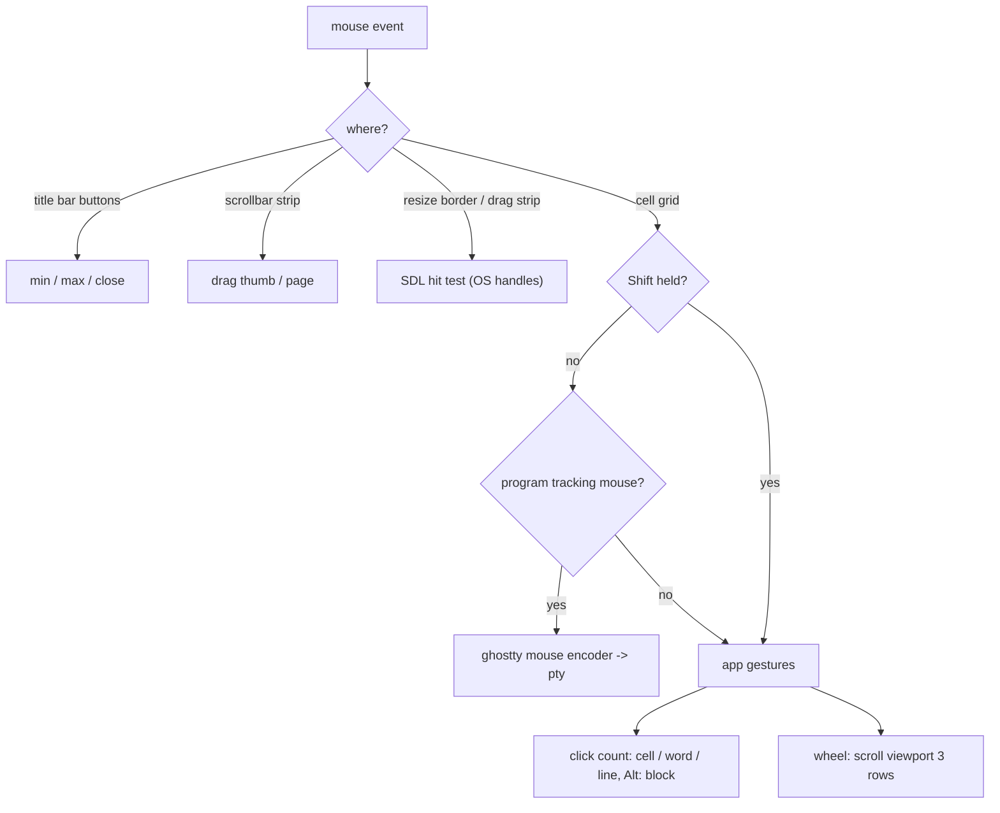
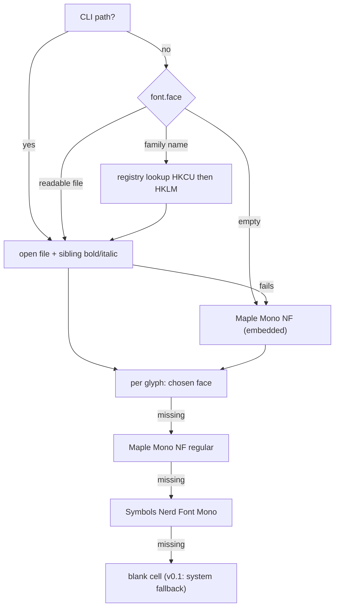
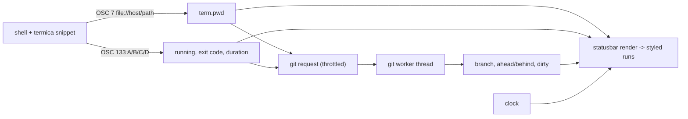
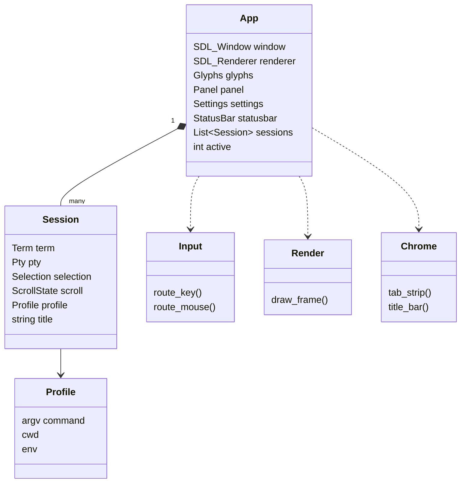

# termica design

This document covers how termica is put together and why. The first half
describes the architecture as it stands at v0.0. The second half is a set of
**architecture decision records** (ADRs), each one short, self-contained and
linked back to the code. The measurements and dead ends behind these
decisions are in the [archived diary](docs/archive/PLAN-milestones-0-9.md).

- [System overview](#system-overview)
- [Modules](#modules)
- [Data flow](#data-flow)
- [Threading model](#threading-model)
- [Input routing](#input-routing)
- [Rendering](#rendering)
- [Configuration lifecycle](#configuration-lifecycle)
- [Status bar](#status-bar)
- [Target architecture (v0.2)](#target-architecture-v02)
- [Decision records](#decision-records)

---

## System overview

termica is a thin **embedder** around libghostty-vt. The library owns
everything that is terminal semantics. termica owns everything that is
Windows, pixels or policy.



**The boundary rule:** if the behaviour is defined by a VT spec (parsing,
modes, encoding, reflow, selection semantics), it comes from libghostty-vt.
termica adds gestures, drawing, process management and user-facing policy.
It never reimplements an escape sequence.

## Modules

| Module | Responsibility | Depends on |
|---|---|---|
| `main.c` | Entry point, CLI parsing, startup/teardown, timers, `fit_grid`, event loop | `app`, `session`, `input`, `render`, `chrome`, `console`, `embed`, `font_lookup` |
| `app.h` | Shared `App` struct, layout/timer constants and `SDL_EVENT_USER` codes | `session`, `git`, `glyph`, `panel`, `settings`, `statusbar`, `window` |
| `session.{h,c}` | Per-tab terminal, ConPTY, search, selection, IME and bounded output pump | `term`, `pty`, `search`, SDL |
| `input.{h,c}` | Keyboard, text/IME, mouse, search and hyperlink interaction | `app`, `chrome`, `hyperlink` |
| `render.{h,c}` | Damage-tracked grid row cache, search highlights and hovered links | `app`, `chrome`, `style` |
| `chrome.{h,c}` | Frame geometry, tab strip, search overlay and status bar | `app` |
| `term.{h,c}` | Terminal state, encoders, selection and OSC callbacks | libghostty-vt |
| `pty.{h,c}` | Pipes, `CreatePseudoConsole`, child process, job object, reader thread, ring buffer, resize, ordered close | Win32 only, **no SDL** |
| `glyph.{h,c}` | Fonts, bounded glyph atlases, HarfBuzz-shaped runs, fallback and drawing | SDL3_ttf, `embed`, `font_lookup` |
| `style.{h,c}` | Turns a cell style into colours and decorations | pure |
| `geometry.{h,c}` | Squircle math shared by the panel, Liquid Glass SDF and the window region | pure |
| `panel.{h,c}` | Translucent panel fill and border, antialiased corner masks | SDL renderer |
| `glass.{h,c}` | Liquid Glass surface optics (squircle SDF, convex rim refraction, RGB dispersion, Dual Kawase wallpaper blur, opposing-light specular contours and glass capsules) | SDL renderer, `geometry`, WIC (Win32) |
| `window.{h,c}` | Window creation, decoration presets, hit test, DWM/composition backdrop, `SetWindowRgn` | SDL, DWM |
| `settings.{h,c}`, `statusbar.{h,c}` | Validated TOML settings and transactional reload | tomlc17 |
| `config_watch.{h,c}`, `ui_settings.{h,c}` | Windows file watch and comment-preserving UI edits | Win32, SDL, tomlc17 |
| `search.{h,c}` | Incremental scrollback search and match navigation | libghostty-vt, PCRE2 |
| `hyperlink.{h,c}` | OSC 8 and detected URLs, scheme validation and opening | libghostty-vt, Win32 |
| `clipboard.{h,c}`, `desktop_signal.{h,c}` | Clipboard read policy, notifications and taskbar progress | SDL, Win32 |
| `diagnostics.{h,c}` | Local log, version and unhandled-exception minidump | Win32, DbgHelp |
| `toast.{h,c}` | In-window reload and save error feedback | SDL |
| `git.{h,c}` | Background `git status --porcelain=v2 --branch` and its parser | Win32 |
| `font_lookup.{h,c}` | Installed family name → `.ttf` path through the registry | Win32 |
| `embed.{h,c}`, `fonts.rc.in` | Fonts compiled in as RCDATA (IDs 1-4: Maple Mono NF, 5: Symbols NF) | Win32 resources |
| `console.{h,c}` | Reattaches the launching console for diagnostics (GUI-subsystem exe) | Win32 |
| `selftest.c` | Headless checks, including real ConPTY round trips | all of the above |

`style.c` and `geometry.c` have no SDL or Win32 state, and `pty.c` has no
SDL dependency. That separation is what keeps most of the code headless-testable.

## Data flow

### A keystroke, round trip



### Process lifecycle



## Threading model

```mermaid
flowchart LR
    subgraph Main["Main thread"]
        ev["SDL event loop"]
        tw["term_write / term_paste / term_resize"]
        draw["render"]
        pw["pty_write"]
    end
    subgraph Reader["pty reader thread"]
        rf["ReadFile"] --> ring[("bounded ring buffer")]
    end
    subgraph Git["git worker"]
        gs["git status (deadline-bounded)"]
    end
    ring -->|pty_read (main)| tw
    rf -->|SDL_PushEvent only| ev
    gs -->|result polled by main| ev
```

These rules are invariants, so don't break them:

1. **Only the main thread touches the terminal.** `term_write`, `term_paste`
   and `term_resize` all run on it. The `WRITE_PTY` reply callback runs inside
   `term_write`, so it is on the main thread too.
2. **The reader thread only copies bytes and wakes the loop.** It never calls
   SDL rendering or terminal APIs.
3. **Backpressure is real.** When the ring buffer is full, the reader waits on
   a condition variable. That stalls conhost, which stalls the child. Memory
   stays bounded, and that is the correct terminal behaviour.
4. **Nothing mutates the terminal inside a libghostty callback.** The VT
   stream is paused there. Callbacks record state, and the main loop acts on
   it afterwards.
5. **Grid refs are snapshots.** They stay valid only until the next mutating
   call. Long-lived anchors use `GhosttyTrackedGridRef`.

## Input routing

### Keyboard



Text keys bypass the encoder because SDL delivers their character separately as
`SDL_EVENT_TEXT_INPUT`. Sending both is not merely redundant: in Kitty keyboard
modes the encoder turns an ordinary letter into a CSI-u sequence, so the program
would receive the character twice. Shortcut keys still use the encoder, and any
text SDL produces for one of those is dropped.

### Pointer



## Rendering

Each frame is drawn from libghostty's **render state**. Search and hyperlink
lookup also read grid snapshots on the main thread; those snapshots are not
retained across terminal mutations.

1. Panel: either the translucent fill with squircle masks, or a light tint
   over the DWM backdrop.
2. Title bar, when enabled for a custom frame.
3. Images in the **below-background** layer, over the panel fill but under
   every cell background.
4. Cell backgrounds, then images in the **below-text** layer, then glyphs and
   decorations, then images in the **above-text** layer. Within a layer,
   placements are sorted by z-index and then by image id, and every image
   layer is clipped to the cell grid.
5. Backgrounds and text are cached as two premultiplied transparent row layers
   per row. Only damaged rows are repainted; all row layers are composited
   onto each fresh window frame. Unsupported render targets fall back to
   direct rendering in the same order.
6. Glyphs share bounded texture atlas pages, with separate style and colour
   entries and whole-page eviction. Oversized glyphs use a temporary texture.
   Adjacent printable-ASCII cells with the same style and colour are shaped
   as one HarfBuzz run when `[font] ligatures` is enabled (the default), so
   ligatures stay whole; every glyph is still drawn at its own cell's x, so
   the grid never drifts.
7. Decorations: the five underline kinds, strikethrough, overline.
8. Cursor (block, hollow, bar or underline, with a blink phase) and the IME
   preedit.
9. Status bar: a second `Glyphs` instance with its own font.
10. Scrollbar thumb.

### Font resolution



## Configuration lifecycle

Both files load over defaults at startup. On Windows, an overlapped
`ReadDirectoryChangesW` watch signals changed names; the main loop reloads a
fresh candidate and applies it only after validation. A failed reload keeps
the previous configuration and displays a toast. Font, colors, keys,
scrollback, window settings and status bar changes apply to running sessions.

UI changes write only the affected key. The editor preserves other bytes and
comments, compares the file before replacing it, and uses an atomic rename.
Closing the app does not rewrite either file.

## Status bar

The status bar follows the Starship model. There are three containers,
`format`, `center_format` and `right_format`, each a string of `$module`
tokens and literals. Each module's `format` is a template of
`[text]($style)` groups, with `$symbol` and `$value` substituted. A single
space after a module that renders empty is dropped, which is why the git
section disappears cleanly outside a repository.



OSC 9;9 emitters may wrap absolute Windows paths in quotes; the callback
removes a matching pair for drive and UNC paths. For integrations that emit
OSC 133 B and D but no C, an unmodified Enter at the marked prompt supplies
an approximate start time. A C marker takes precedence. An unmatched D
updates status but cannot supply a duration.

<details>
<summary>The built-in default <code>statusbar.toml</code></summary>

```toml
format = "$directory"
center_format = "$git_branch $git_status"
right_format = "$cmd_duration $cmd_status $time  $busy"

[font]
face = ""
size = 11.0

[directory]
format = "[$symbol $value]($style)"
symbol = ""
style = "fg:#9ccfd8 bold"
truncation_length = 1
home_symbol = ""

[git_branch]
format = "[$symbol $value]($style)"
symbol = ""
style = "fg:#c4a7e7 bold"

[git_status]
format = "[$value]($style)"
symbol = ""
style = "fg:#ebcb8b"
ahead = "⇡ "
behind = "⇣ "
diverged = "⇕ "
dirty = " "
clean = "✓ "
conflicted = "= "

[cmd_status]
format = "[$symbol]($style)"
symbol = ""
style = ""
style_success = "fg:#a3be8c"
style_failure = "fg:#bf616a"
symbol_success = "✓"
symbol_failure = "✗"

[cmd_duration]
format = "[$symbol$value]($style)"
symbol = ""
style = "fg:#ebcb8b"
min_time = 0

[time]
format = "[$symbol$value]($style)"
symbol = "󰥔 "
style = "fg:#d8dee9"
time_format = "%H:%M"

[busy]
format = "[$symbol]($style)"
style = "fg:#F54F2E"
```

</details>

## Target architecture (v0.2)

`App` owns shared window state and a list of independent `Session`s, each
with its own terminal, ConPTY, search and selection state.



What doesn't change: the threading rules (one reader thread per session, with
every terminal still mutated only on the main thread) and the boundary rule.

---

## Decision records

The format is **Context** (why a decision was needed), **Decision**, and
**Consequences** (including the costs). The status is *Accepted* unless noted
otherwise.

### ADR-001: libghostty-vt as the emulation core

- **Context:** Writing a correct VT parser, screen model, reflow and key
  encoder is years of work.
- **Decision:** Use libghostty-vt for parsing, screens, scrollback, reflow,
  selection semantics, and key, mouse, focus and paste encoding. CMake
  downloads the **prebuilt Windows release zip**, pinned to a version with
  a checksum, so no Zig toolchain is needed.
- **Consequences:** termica inherits Ghostty's fidelity, including the kitty
  keyboard protocol. Behaviour bugs often belong upstream. API changes are
  absorbed when `GHOSTTY_VERSION` is bumped.

### ADR-002: C99 + SDL3 + SDL3_ttf

- **Context:** The project needs per-pixel transparency, GPU rendering, IME
  and input, on a small dependency footprint.
- **Decision:** Strict C99 for project code, built with
  `-Wall -Wextra -pedantic`. SDL3 provides the window, events and renderer
  (Direct3D 11/12), and SDL3_ttf the glyphs. Dependencies are pinned through
  FetchContent.
- **Consequences:** The result is one static executable that depends only on
  system DLLs. Effects SDL does not expose, such as DWM materials and window
  regions, are done with Win32 through the `HWND`.

### ADR-003: llvm-mingw toolchain, no MSVC

- **Decision:** Build with clang + lld + MinGW-w64 (llvm-mingw), installed
  from Scoop and driven by CMake presets and Ninja. A `gcc` preset is kept as
  an alternative.
- **Consequences:** No Visual Studio install is needed. SDL3 still needs a C++
  compiler, so the presets set one. LeakSanitizer is unavailable for
  `windows-gnu`, which leaves ASan and UBSan only.

### ADR-004: ConPTY transport with a reader thread and a bounded ring buffer

- **Context:** The shell has to run in a real pseudoconsole, and output must
  never block the UI.
- **Decision:** `pty.c` creates two anonymous pipes and
  `CreatePseudoConsole`. A reader thread copies `ReadFile` output into a
  bounded ring buffer and wakes the main loop with `SDL_PushEvent`. A full ring
  buffer blocks the reader, which is the backpressure. `pty.c` has no SDL
  dependency, and notification goes through a callback.
- **Consequences:** Memory stays bounded and the module is testable headlessly.
  Writes are still synchronous on the main thread, which is why large pastes
  block (fixed by PLAN 1.7). UTF-8 sequences split across reads are safe,
  because only `term_write` consumes the byte stream.

### ADR-005: Process tree ownership

- **Decision:** Start the child **suspended**, assign it to a
  `JOB_OBJECT_LIMIT_KILL_ON_JOB_CLOSE` job, then resume it. Closing the
  pseudoconsole is the primary shutdown path, and the job is the safety net.
  When the shell exits, the window closes.
- **Consequences:** Closing the window can never leave `conhost.exe` or
  grandchildren behind. The last output of a crashed shell is not kept on
  screen.

### ADR-006: Child environment and standard handles

- **Decision:** The child gets termica's environment, with `TERM` filled in if
  it is missing or `dumb`, `COLORTERM` filled in if it is missing, and
  `TERMICA=1` and `TERMICA_SHELL_INTEGRATION=1` added. It is created with
  `STARTF_USESTDHANDLES` and NULL handles, so conhost attaches the
  pseudoconsole instead of the console that launched termica.
- **Consequences:** Prompt tools stop degrading to dumb mode, and the
  integration snippets can detect termica. No `chcp 65001` is needed, because
  ConPTY round trips UTF-8, which the self test verifies with non-ASCII
  arguments.

### ADR-007: Main-thread-only terminal mutation

- **Decision:** See [Threading model](#threading-model). All libghostty calls
  happen on the main thread, and callbacks only record state.
- **Consequences:** The terminal needs no locks. This must be kept when
  sessions multiply (v0.2).

### ADR-008: App bindings live under Ctrl+Shift, Alt belongs to the shell

- **Context:** Readline and PSReadLine Meta bindings use `Alt+*`, and
  `Ctrl+Alt` is AltGr on many keyboard layouts.
- **Decision:** Every app action is a `Ctrl+Shift` chord, matched by
  **scancode** (the keycode for Shift+C is not `SDLK_C`). Modifier unions are
  tested per side, because SDL3 `KMOD_*` values are L|R unions.
- **Consequences:** `Alt+b` and `Alt+f` work in shells. One exception remains:
  `Ctrl+V` pastes, which hides vim's visual-block key. PLAN 1.2 makes bindings
  configurable and changes that default.

### ADR-009: Pointer ownership and selection

- **Decision:** If a program enables mouse tracking, grid events go to the
  mouse encoder. **Shift** always takes the pointer back. The wheel asks the
  encoder first and scrolls only if nothing was produced. Gestures (click
  count, drag) belong to termica. Selection semantics (word boundaries, line
  extents, tracking through reflow) come from libghostty. A drag anchor is a
  `GhosttyTrackedGridRef`, so output that arrives mid-drag cannot slide it.
- **Consequences:** `fzf` and vim get the mouse, while scrollback and selection
  stay reachable. The selection is shown by swapping colours, so no extra
  colour is needed. Copy is explicit (`Ctrl+Shift+C`), with copy-on-select as
  an opt-in.

### ADR-010: Clipboard policy

- **Decision:** Pasting goes through `ghostty_terminal_paste`, which handles
  bracketed paste and detects unsafe pastes. An unsafe paste asks for
  confirmation. OSC 52 writes default to **`ask`**, because a remote host
  could otherwise replace the clipboard silently. OSC 52 reads are not
  answered yet.
- **Consequences:** The defaults are safe and the user can opt in to more.
  The policy dialog runs outside the VT callback (see ADR-007).

### ADR-011: TOML configuration with strict typing and edit-safe saves

- **Context:** The original `key = value` format could not express sections
  or types, and saving on exit overwrote edits made while termica was running.
- **Decision:**
  - The parser is tomlc17, built as its own C17 target. Files are read with
    `SDL_LoadFile` rather than narrow `fopen`, so non-ASCII profile paths work.
  - Values are validated by TOML type and range. `nan` and `inf` are rejected.
    A bad value keeps the previous one.
  - A syntax error rejects the whole document.
  - Key names fold case and `-`/`_`.
  - Saves write a temporary file and rename it over the original. A save is
    **skipped** if the FNV-1a fingerprint on disk differs from what was loaded.
- **Consequences:** A file can never be half-written or have a hand edit
  clobbered. Comments are lost on the canonical rewrite, which PLAN 2.9
  revisits. Changes need a restart until hot reload (PLAN 2.5).

### ADR-012: Fonts are embedded, and families are resolved through the registry

- **Decision:** Maple Mono NF (all four faces) and Symbols Nerd Font Mono are
  compiled in as RCDATA resources, roughly 9.5 MB. `font.face` accepts a path
  or an installed family name, resolved from the HKCU and then HKLM font
  registry, with `Regular` preferred. Sibling bold and italic faces are
  discovered by naming convention, and bold is faked when there is no bold face.
- **Consequences:** Icons and prompts work with nothing installed. The
  executable is large. CJK and emoji are missing (PLAN 1.5). The glyph cache
  covers the BMP only, so out-of-BMP glyphs are drawn uncached.

### ADR-013: Custom window chrome on DWM

- **Context:** The target look is borderless and translucent, with
  macOS-style continuous corners and optional Windows 11 materials.
  `DWMWA_WINDOW_CORNER_PREFERENCE` does nothing for a per-pixel transparent
  window.
- **Decision:** termica draws a **squircle** panel (`(u/r)^4 + (v/r)^4 <= 1`,
  10 pt radius, 4×4 supersampled masks). Mica, Mica Alt and Acrylic come from
  `DWMWA_SYSTEMBACKDROP_TYPE` plus `DwmExtendFrameIntoClientArea(-1)`, with the
  window shaped by `SetWindowRgn`. Frames come as presets (`rounded`,
  `square`, `compact`, `native`) rather than separate knobs. `native` is the
  escape hatch back to the real Windows frame. The drawn title bar's buttons
  are `SDL_HITTEST_NORMAL`.
- **Consequences:** The look is distinctive. With a backdrop on, the region's
  corners are aliased and clicks outside the shape pass through. Windows 10
  falls back to the panel. A rebuild on DPI change is needed (PLAN 1.4).

### ADR-014: GUI subsystem with console reclaim

- **Decision:** `WIN32_EXECUTABLE`, so no console appears on double-click.
  `console.c` reattaches the parent console for diagnostics only when no
  standard handles were given, and leaves pipes and redirected handles alone.
- **Consequences:** `--selftest` output can still be captured. `run.ps1` must
  wait for the process explicitly.

### ADR-015: Status bar data comes from shell integration, not process inspection

- **Context:** The working directory could be read from the child's PEB, but
  PowerShell does not keep its process directory in sync with `$PWD`.
- **Decision:** Use the standard sequences: OSC 7 for the directory and OSC 133
  A/B/C/D for prompt and command boundaries, decoded by libghostty callbacks.
  Opt-in snippets for pwsh, bash and zsh **wrap** the existing prompt. Git
  runs on a worker thread with a deadline, closes its own pipe handles and is
  throttled. The spinner glyphs are fixed in code.
- **Consequences:** It works with Starship and oh-my-posh, and the same
  protocol works over ssh. Without the snippet, the bar degrades to the
  spawn directory and hides the command modules. A `git` that hangs can never
  hang shutdown.

### ADR-016: Verification policy

- **Context:** Synthetic desktop-wide input (`SendKeys`, `mouse_event`) lands
  in whichever window is focused, and it disturbs the user's session.
- **Decision:** These count as evidence:
  - The headless `--selftest`.
  - Messages posted to termica's own `HWND`.
  - A visible change in termica's own pixels.

  These do **not** count:
  - Desktop-wide injection whose only proof is outside the window (the
    clipboard, an absent dialog).
  - Any negative result.

  Features that can only be checked with real input are listed as manual
  checks in the stage checklist.
- **Consequences:** Claims stay honest. Some features (IME, autoscroll, the
  OSC 22 cursor) wait for a human pass before release (see PLAN v0.1 exit
  criteria).

### ADR-017: Bounded search, explicit desktop effects and live config

- **Decision:** Search uses PCRE2 with bounded work per frame; terminal grid
  access stays on the main thread. Each session's output pump is bounded so
  continuous output cannot monopolize the event loop. Hyperlinks are resolved
  at the pointer and only HTTP, HTTPS and mailto URIs reach the OS.
- **Decision:** OSC clipboard reads and notifications are policy-gated and
  default to deny. Notifications and taskbar progress are dispatched outside
  libghostty callbacks. Windows toast registration is deferred until an
  approved notification.
- **Decision:** Watch both TOML files and apply validated snapshots live. Save
  only keys changed through the UI rather than rewriting the file on exit.
- **Consequences:** Search can advance incrementally over large histories;
  Windows controls whether a submitted toast is displayed. A simultaneous
  external edit can still race the final compare-and-rename of a UI save.

### ADR-018: Retained rows and bounded glyph atlases

- **Decision:** SDL target textures retain each grid row independently; the
  renderer repaints damaged rows, then composites all layers over the fresh
  panel. Premultiplied alpha preserves translucent backgrounds and a direct
  drawing fallback is used if render targets or blending are unavailable.
  Glyphs, text clusters and shaped glyph indices share bounded atlas pages;
  eviction invalidates entries through generation counters. Device reset
  discards both caches.
- **Consequences:** Chrome and overlays remain fresh without rerasterizing
  unchanged grid rows. Render-target memory scales with the viewport, and
  unsupported graphics backends still draw complete frames correctly.

### ADR-019: Local crash diagnostics and release identity

- **Decision:** On Windows, write a local log and a normal minidump for an
  unhandled exception. The exception filter delegates dump writing to a
  prestarted worker so stack overflows have a separate stack. Set
  `TERMICA_DIAGNOSTICS=0` to disable diagnostics; `--version` reports the
  build and loaded libghostty version without starting the UI.
- **Consequences:** Minidumps may contain private memory, paths and secrets;
  reports must not be published without review. Authenticode signing is a
  separate fail-closed step requiring a provisioned trusted certificate and
  timestamp service, and does not guarantee SmartScreen reputation.

### ADR-020: Images come from libghostty, sixel is not reimplemented

- **Context:** Programs draw pictures with the Kitty graphics protocol and,
  historically, sixel. ADR-001 makes libghostty-vt the only parser of escape
  sequences, so termica may draw images but must not grow a competing one.
  libghostty-vt 1.0.1 parses Kitty graphics and exposes storage, pixels and
  render-state placements; it does not parse sixel. Kitty graphics travel in
  APC sequences, and ADR-004's ConPTY transport consumes APC on every current
  Windows version, so a program in a tab cannot deliver an image yet.
- **Decision:** Add `image.c` as a texture cache and pasteboard, not a parser.
  `term.c` keeps a bounded 32 MiB Kitty storage, leaves the file and
  shared-memory media disabled so only in-band payloads are accepted,
  installs SDL's PNG decoder with `ghostty_sys_set` before the first terminal
  exists, and the renderer reads placements from
  `GHOSTTY_RENDER_STATE_DATA_IMAGE_ITERATOR`. Textures are keyed by image id
  and image generation, capped at 32 entries and 64 MiB with
  least-recently-used eviction, and drawn in the below-background, below-text
  and above-text layers sorted by z. Animation ticks run once per frame and
  schedule a single redraw no sooner than 8 ms. Sixel is documented as
  unsupported until upstream parses it; termica adds no second protocol
  parser.
- **Consequences:** Image correctness, protocol quirks and animation timing
  follow the library. The renderer is exercised by `--selftest` and by
  synthetic input fed straight into the terminal; a real program inside a
  termica tab still cannot display an image until the ConPTY limitation is
  solved. Supporting sixel later needs a protocol value in the render state
  and a matching branch in `image.c`, but still no escape-code parser here.
  Image textures are an extra memory cost on top of terminal storage, and a
  program that scrolls through large screenshots pays texture uploads until
  the cache evicts them. Sixel users need another terminal.

### ADR-021: Ligatures come from shaped ASCII runs, not per-cell glyphs

- **Context:** Programming fonts draw `->`, `=>`, `===` and similar sequences
  as one glyph spanning several cells. Per-cell drawing cannot see across
  the cell boundary, so those glyphs never appear. SDL_ttf already shapes
  text with HarfBuzz internally but does not expose the shaped glyphs; it
  does expose text layout operations and `TTF_GetGlyphImageForIndex()`.
- **Decision:** Group adjacent cells that are single printable-ASCII
  characters with the same face, bold/italic state, foreground colour,
  decorations and hyperlink state. Lay the group out as one `TTF_Text` with
  no drawing engine, then read its copy operations. A one-cell cluster is
  positioned from its own bearing, so the grid never accumulates font-advance
  drift; a multi-cell cluster is re-shaped on its own and drawn at the first
  cell. Shaped glyph indices use a separate face/index cache and the same
  bounded atlas as ordinary glyphs. `[font] ligatures = false` turns run
  shaping off and forces the per-cell path; a live change invalidates the row
  cache. Cursors, wide cells, fallback faces, combining clusters and control
  characters keep the per-cell path. If shaping cannot be initialised, the
  terminal silently falls back to per-cell drawing.
- **Consequences:** Fonts with programming ligatures render them without
  changing cell geometry, selection or cursor behaviour. Colour changes,
  cursors and fallback cells split a run, so a ligature can disappear when
  its cells are styled differently. Layout costs one shape per styled run in
  a damaged row, and a few hundred bytes for the run buffer. The
  implementation depends on SDL_ttf's public text-layout operation
  structure, which is pinned with the dependency.

### ADR-022: Liquid Glass backdrops (`glass` and `glass_dark`)

- **Context:** Windows 11's built-in Mica only blurs the desktop wallpaper and
  System Acrylic enforces a heavy matte tint with coarse grain that turns
  opaque when unfocused. Users want Apple Tahoe-style Liquid Glass materials:
  both an airy clear variant and a deeper smoked/obscure variant (like Tahoe's
  dark Clipboard / Golden Gate cards) that preserves effortless text contrast
  over bright, colourful wallpapers.
- **Decision:** Add `WINDOW_BACKDROP_GLASS` (`backdrop = "glass"`, aliased as
  `"liquid_glass"` / `"liquid-glass"`) and `WINDOW_BACKDROP_GLASS_DARK`
  (`backdrop = "glass_dark"`, aliased as `"glass_alt"`, `"glass_obscure"`, etc.).
  On Windows, `window.c` enables clear, grain-free live behind-window blur via
  `SetWindowCompositionAttribute` (`ACCENT_ENABLE_BLURBEHIND`), restoring SDL's
  empty `DwmEnableBlurBehindWindow` region when switching back to `panel` so
  per-pixel alpha survives mode changes. Over that live blur, `glass.c`
  synthesizes a cached low-resolution optical body texture (3-stop
  cubic-smoothstep vertical glass veil, screen-space convex circular-cap rim
  refraction and RGB chromatic dispersion sampled from a hexagonal-Kawase-filtered
  WIC desktop wallpaper buffer, adaptive luminance hotspot suppression in
  `glass_dark` so bright yellow/white wallpaper stripes never wash out glyphs,
  and inward exponential specular sheen) paired with a full-resolution
  4×4-supersampled corner seam atlas, dual-contour opposing-light specular rims
  with pointer-proximity highlights, and shared rounded glass capsules for tabs,
  search and toasts.
- **Consequences:** Live windows behind the terminal blur cleanly even when
  unfocused and remain visible in screenshots (no `WDA_EXCLUDEFROMCAPTURE`
  visibility loss). Screen-space rim refraction couples to the desktop
  wallpaper rather than arbitrary mid-stack windows, keeping frame cost near
  zero when cached and avoiding self-capture feedback loops. All optical math
  and software-rendered pixels are verified headlessly in `--selftest`.
