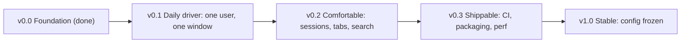

# termica roadmap

This file describes where termica is going and how each stage is judged
finished. For how the code is built, see [DESIGN.md](DESIGN.md). For what
happened in each milestone so far, see the
[archive](docs/archive/PLAN-milestones-0-9.md).

## Ground rules for every stage

- **Exit criteria are testable.** Each item is either a `--selftest` check, or
  a manual check written into the stage's checklist and then ticked off on
  real hardware. See the verification policy in
  [DESIGN.md › ADR-016](DESIGN.md#adr-016-verification-policy).
- **No warnings.** The build is clean under `-Wall -Wextra -pedantic`, and the
  ASan/UBSan self test passes.
- **Config compatibility.** A `termica.toml` from an earlier v0.x stage still
  loads. Keys can be added or deprecated with an alias, but never silently
  reinterpreted.
- **Docs move with the code.** Every stage updates the README feature table and
  adds any new decision to DESIGN.md as an ADR.

---

## v0.0 Foundation (done)

This stage proved the stack and built the core. It covers milestones 0-9,
up to commit `c9ed5dd`.

| Milestone | Delivered |
|---|---|
| 0 | SDL3 borderless, translucent window, squircle panel, Nerd Font look |
| 1 | libghostty-vt drives a real grid: SGR, cursor, erase, wide chars, key encoder |
| 2 | ConPTY shell: reader thread, ring buffer, resize, kill-on-close job, built-in font |
| 3 | Mouse reporting, scrollback UI, selection and copy, focus events |
| 4 | Five underline kinds, tracked selection anchor, Alt left to the shell, scrollbar control, GUI subsystem |
| 5 | Settings file, OSC 52, copy-on-select, OSC 22 pointer shape, IME preedit, selection autoscroll |
| 6 | TOML settings (tomlc17), installed font family lookup |
| 7 | Window decoration presets, drawn title bar |
| 8 | `font.face` key, edit-safe saves, `run.ps1` fixes |
| 9 | Starship-style status bar, shell integration (OSC 7/133), background git, Symbols NF fallback |

**Carried forward:** these items were never machine-verified and must be
checked by hand before v0.1 is tagged: copy-on-select, selection autoscroll,
OSC 22 pointer shape, the OSC 52 `ask` dialog, IME preedit, and the title-bar
buttons.

---

## v0.1 Daily driver

**Goal:** one person can use termica as their only terminal for a full working
week, in a single window.

### Scope

| # | Item | Acceptance criteria |
|---|---|---|
| 1.1 | **Shell profiles** (done) | `[terminal] command = ["wsl.exe", "-d", "Ubuntu"]` (an argv array), plus `cwd` and `[terminal.env]`. `shell = "auto"` keeps working. WSL, Git Bash and `ssh host` start and resize correctly. A command that fails to start shows an on-screen error. |
| 1.2 | **Configurable key bindings** (done) | A `[keys]` table maps chords to actions (`copy`, `paste`, `scroll_page_up`, `scroll_page_down`, `font_size_up`, `quit`, ...). The default `paste` is `Ctrl+Shift+V` only, so `Ctrl+V` reaches the program. `Ctrl+V` can be bound back with one line. Bindings match scancodes. |
| 1.3 | **Font zoom** (done) | `Ctrl+=` / `Ctrl+-` / `Ctrl+0` (bindable) change the size live: re-open the glyphs, refit the grid, resize the pty. The selection and scrollback survive. The zoom is not persisted unless the user saves it. |
| 1.4 | **Per-monitor DPI** (done) | `SDL_EVENT_WINDOW_DISPLAY_SCALE_CHANGED` rebuilds the glyph cache, the panel corner masks and the chrome metrics. Text stays sharp when the window is dragged between 100% and 150% monitors. |
| 1.5 | **Font fallback chain** (done) | A configured `font.fallback = [...]` list, then OS CJK/colour-emoji fallback fonts, then Symbols NF. CJK text and colour emoji render without tinting, and tall glyphs scale to fit. An out-of-BMP hash cache covers codepoints above U+FFFF. |
| 1.6 | **Colour schemes** (done) | `[colors]` sets foreground, background, cursor, selection and the 16-colour palette, through libghostty's palette API. One bundled default (`dark`) and one `light` scheme. A self test checks that the palette reaches the render state. |
| 1.7 | **Asynchronous paste writer** (done) | Pastes and keystrokes go through a single FIFO writer thread in `pty.c`. Large pastes do not freeze the UI, and byte order against key input is preserved. |
| 1.8 | **Bell** (done) | `[terminal] bell = "visual" \| "taskbar" \| "none"`. The visual bell flashes the panel. The taskbar option calls `FlashWindowEx` when the window is unfocused. |

### Out of scope

Tabs, splits, search, hyperlinks, packaging.

### Exit criteria

- All items above are done, and the v0.0 carried-forward manual checks are ticked.
- A one-week dogfood log in `docs/dogfood-v0.1.md` lists no blocker bugs.
- `--selftest` covers 1.1 (argv parsing, env block), 1.2 (chord parsing and
  dispatch), 1.5 (fallback selection), 1.6 (palette) and 1.7 (queue ordering).

---

## v0.2 Comfortable

**Goal:** the features people expect from a modern terminal, built on a
codebase that can grow.

### Scope

| # | Item | Acceptance criteria |
|---|---|---|
| 2.1 | **Split up `main.c`** (done) | Extract `Session` (terminal + pty + selection + scroll state) from `App`, and separate `input.c`, `render.c`, `chrome.c` and `session.c`. No behaviour change, and the self test is unchanged. `main.c` shrunk from 2,741 to 513 lines. See [DESIGN.md › Modules](DESIGN.md#modules). |
| 2.2 | **Tabs** (done) | `Ctrl+Shift+T` opens a tab, `Ctrl+Shift+W` closes one, `Ctrl+Tab` / `Ctrl+Shift+Tab` switches (plus mouse click, middle-click/× close, `+` button). The tab strip is drawn in the title-bar area for custom frames, and as a top strip under `native` when >1 tab is open. Closing the last tab closes the window. |
| 2.3 | **Scrollback search** (done) | `Ctrl+Shift+F` opens an overlay. Matches are highlighted across scrollback, with next/previous navigation and case/regex toggles. |
| 2.4 | **Hyperlinks** (done) | OSC 8 links and auto-detected URLs are underlined on hover and open on `Ctrl+click` through `ShellExecuteW`, after scheme allow-listing. |
| 2.5 | **Hot reload** (done) | `termica.toml` and `statusbar.toml` are watched with `ReadDirectoryChangesW`. Changes apply live: font, colours, keys, status bar. Invalid edits keep the old config and show a toast. |
| 2.6 | **Notifications and progress** (done) | OSC 9 / 777 notifications become Windows toasts, policy-gated like OSC 52. OSC 9;4 progress drives the taskbar progress bar (`ITaskbarList3`). |
| 2.7 | **OSC 52 read** (done) | Clipboard reads are answered under the same `ask`/`allow`/`deny` policy, with `deny` as the default. |
| 2.8 | **Configurable scrollback** (done) | `[terminal] scrollback_lines`, with a default and an upper bound. |
| 2.9 | **Comment-preserving config** (done) | The canonical rewrite on exit is dropped. termica writes only when a value actually changed through the UI, and edits that key in place. |

### Exit criteria

- [x] 2.1 is merged first, as its own reviewable change (`87236ab`).
- [x] Search, the URL detector, the reload diff and the OSC 9;4 parser have self tests.
- [x] Ten tabs running `yes` concurrently stay responsive. Closing a tab leaves no
  orphaned processes (verified on Windows with ten ConPTY children).

---

## v0.3 Shippable

**Goal:** someone other than the author can install it, update it and report bugs.

| # | Item | Acceptance criteria |
|---|---|---|
| 3.1 | **CI** | A GitHub Actions workflow builds with llvm-mingw and runs `--selftest` and the ASan self test on every push and PR. |
| 3.2 | **Performance pass** (done) | A glyph atlas replaces one texture per glyph. Only damaged rows are redrawn. Benchmarks: `cat` of a 100 MB file, `yes` throughput, and frame time while scrolling, compared against Windows Terminal and WezTerm and recorded in `docs/perf.md`. |
| 3.3 | **Packaging** | Versioned release zips. A Scoop manifest and a winget manifest. An app icon and version resource. An Explorer "Open termica here" entry, opt-in. |
| 3.5 | **Crash diagnostics** (done) | A log file in `%LOCALAPPDATA%\termica\logs`, a minidump on unhandled exceptions, and a `--version` output to paste into bug reports. |
| 3.6 | **User docs** (done) | A configuration reference generated from the settings tables, a key binding reference, troubleshooting, and issue templates. |
| 3.7 | **Images** (blocked on transport) | Kitty graphics parsing, storage, layers, clipping and animations work through libghostty-vt and are covered by `--selftest`. Windows ConPTY consumes APC sequences, so no program can deliver an image through the pty yet; the item stays blocked until the transport forwards APC. Sixel is documented as unsupported because the library does not parse it. |
| 3.8 | **Ligatures** (done) | Adjacent printable-ASCII cells with the same style and colour are shaped as one run with SDL_ttf's HarfBuzz support, so `->`, `=>`, `!=` and three-cell sequences use the font's ligature glyphs. Glyphs snap to their cells without drift; the cursor, wide characters, fallback faces and combining clusters keep the per-cell path. `[font] ligatures = false` restores per-cell drawing. Covered by `--selftest` on a software renderer. |

### Exit criteria

Install from Scoop on a clean Windows 10 VM and a clean Windows 11 VM, run it,
update it and uninstall it, with no manual steps.

---

## v1.0 Stable

- The configuration schema is frozen and documented. Breaking changes need a
  major version.
- There are no known crash bugs, and all open issues are triaged.
- The splits decision is made: either native splits, or a documented
  recommendation to use tmux or zellij instead.

---

## Backlog (not scheduled)

- A pty transport that forwards APC sequences, so Kitty graphics can reach
  the parser (ConPTY consumes them today)
- Sixel graphics (blocked on libghostty-vt parsing it; ADR-020 rules out a
  second parser)
- Native splits
- Quake-style drop-down mode with a global hotkey
- IME preedit that pushes text aside instead of overwriting cells, with no
  128-byte limit
- Session restore
- Non-Windows backends (the pty stub exists, and SDL is portable)
